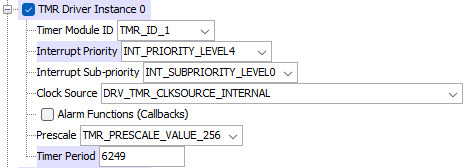
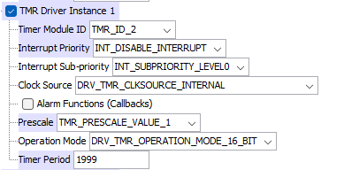
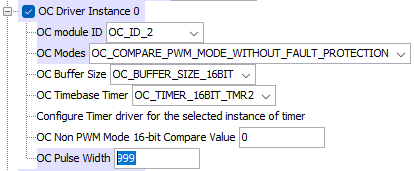
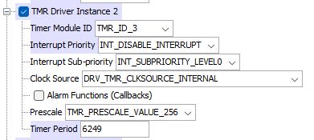
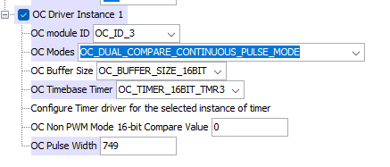
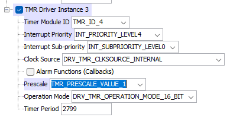

## Configuration du Timer 1
La valeur de recharge du timer 1 a été calculer avec la formule si dessous :

$$
T_{tick} = \frac{SYSCLK \cdot T_{ms} }{Pre} - 1 = \frac{80\,\text{MHz} \cdot 20 \text{ms}}{256} - 1 = 6249
$$

**SYSCLK** : Fréquence de l'horloge du PIC
**Pre** : valeur du prescaler du PIC
**T*ms*** : Fréquence de interruption du timer
**T*tick*** : valeur du registre de reload

J'ai utiliser un prescaler de 256 pour ne pas dépasser la valeur de 16 bits du timer 1.

Paramètre du timer 1 dans Harmony :

## Configuration de Timer 2 et OC 2
La valeur de recharge du timer 1 a été calculer avec la formule si dessous :

$$
T_{tick} = \frac{SYSCLK}{Pre \cdot Freq} - 1 = \frac{80\text{MHz}}{1 \cdot 40\text{kHz}} - 1 = 1999
$$

**SYSCLK** : Fréquence de l'horloge du PIC.

**Pre** : valeur du prescaler du PIC.

**Freq** : Fréquence de interruption du timer.

**T*tick*** : valeur du registre de reload.

J'ai utiliser un prescaler de 1.

Paramètre du timer 2 dans Harmony :

Paramètre de l'OC2 dans Harmony :

Rapport cyclique de 50%

## Configuration de Timer 3 et OC 3
La valeur de recharge du timer 1 a été calculer avec la formule si dessous :

$$
T_{tick} = \frac{SYSCLK \cdot T_{ms} }{Pre} - 1 = \frac{80\,\text{MHz} \cdot 20 \text{ms}}{256} - 1 = 6249
$$

**SYSCLK** : Fréquence de l'horloge du PIC.

**Pre** : valeur du prescaler du PIC.

**T*ms*** : Fréquence de interruption du timer

**T*tick*** : valeur du registre de reload.

J'ai utiliser un prescaler de 1.

Paramètre du timer 3 dans Harmony :

Paramètre de l'OC3 dans Harmony :

Rapport cyclique de 50%

## Configuration du Timer 4
La valeur de recharge du timer 1 a été calculer avec la formule si dessous :

$$
T_{tick} = \frac{SYSCLK \cdot T_{ms} }{Pre} - 1 = \frac{80\text{MHz} \cdot 35 \text{us}}{1} - 1 = 2799
$$

**SYSCLK** : Fréquence de l'horloge du PIC
**Pre** : valeur du prescaler du PIC
**T*ms*** : Fréquence de interruption du timer
**T*tick*** : valeur du registre de reload

J'ai utiliser un prescaler de 1.

Paramètre du timer 4 dans Harmony :

